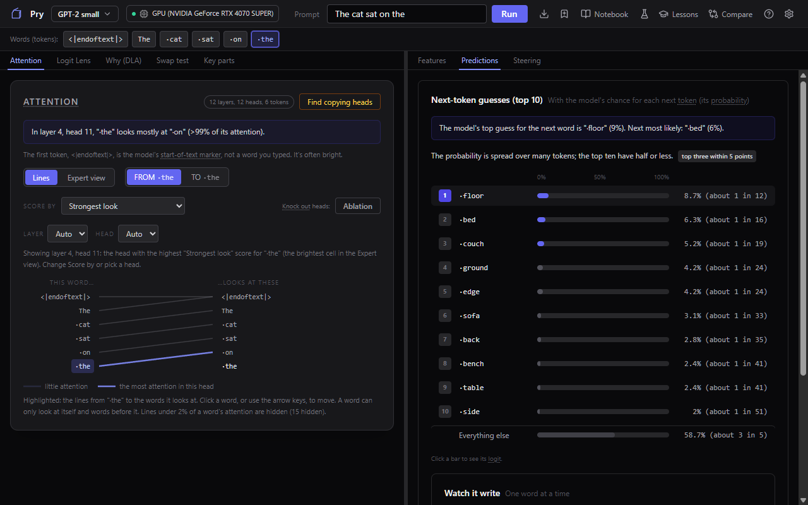
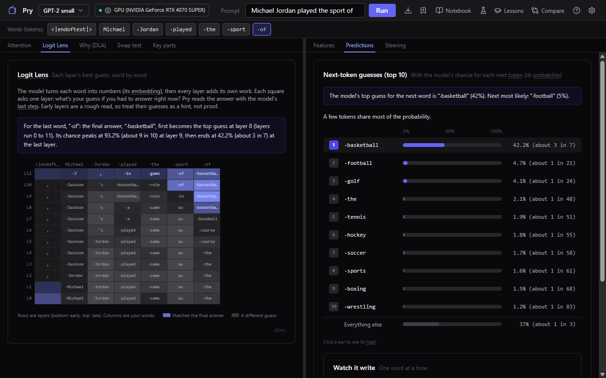
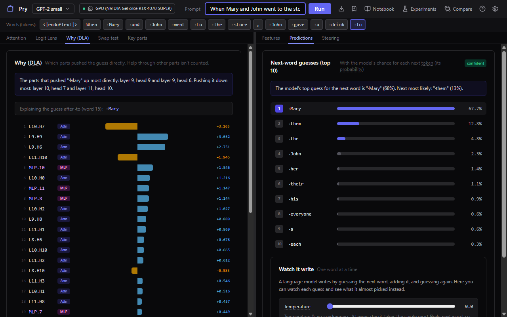
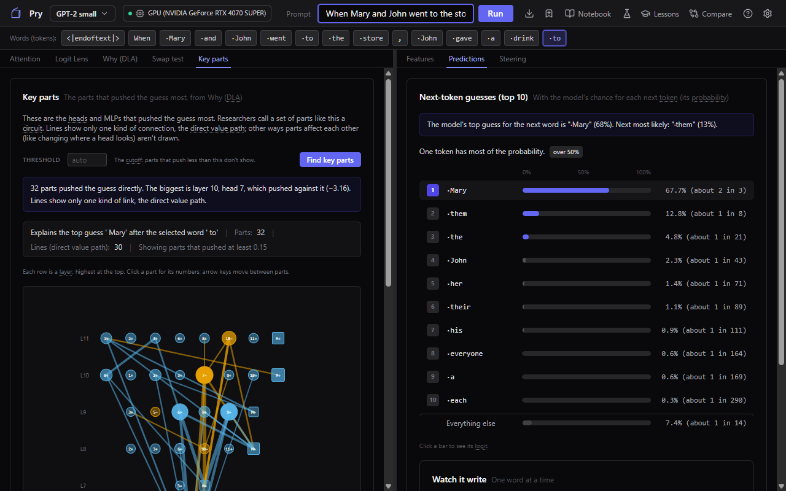
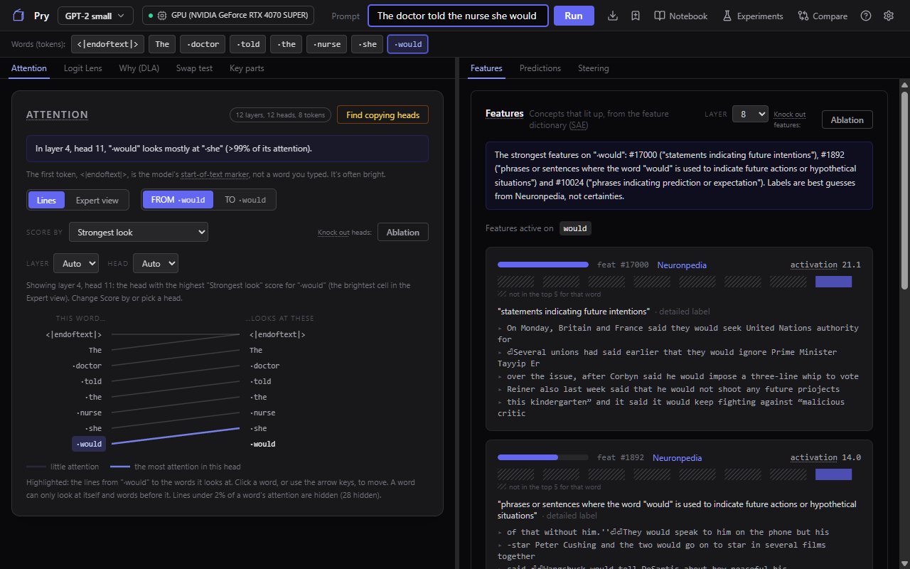
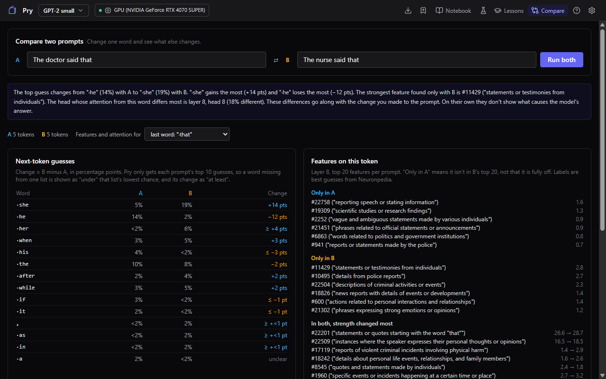
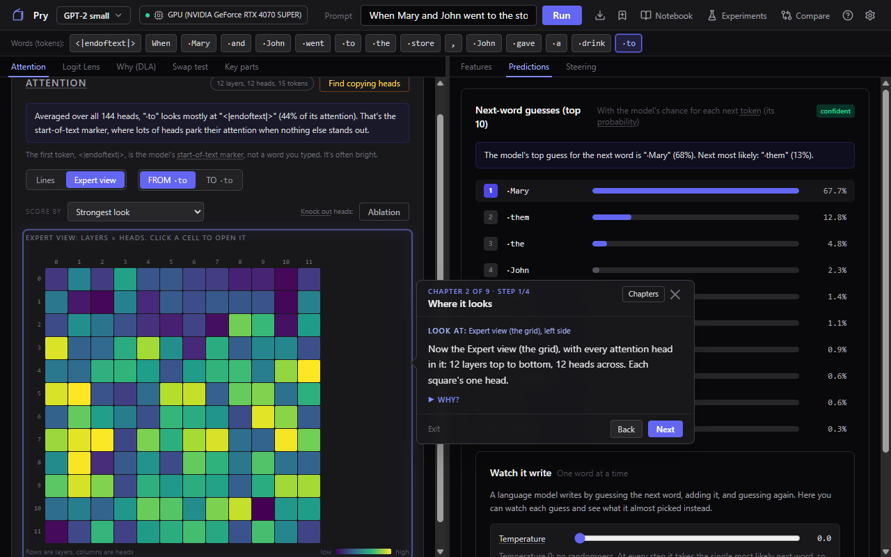
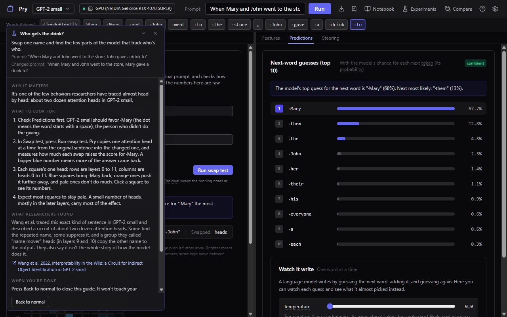
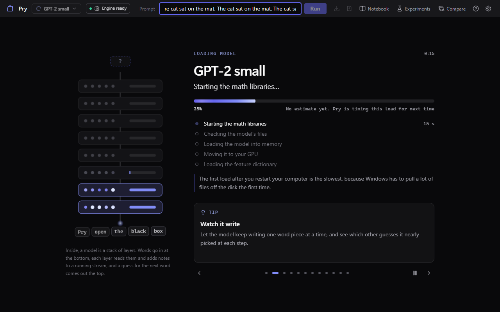

# Pry

Pry lets you look inside a small language model while it reads your words and guesses the next one. You don't need to write code or know machine learning.

It runs the model on your own computer and gives you tools for seeing what's going on inside. Every chart opens with a sentence or two saying what it shows, and a guided tour walks you through the whole app. If you've wondered how these models work but don't want to set up a Python notebook to find out, it's for you.

Pry's an alpha. It works, but you'll hit rough edges.



*Attention and Predictions for "The cat sat on the". On the left, lines run from " the" to the words one head looks at. On the right are the model's top guesses, with " floor" first at 9%.*

## What you can do

- **See what it guesses.** Predictions lists the model's top guesses for the next word and how likely it thinks each one is. Watch it write replays the model writing one word at a time, with a temperature slider.
- **See where it looks.** Attention draws lines from each word to the words it pays attention to. There's an expert view with the full layer × head grid, and a copying-heads view that finds the heads that copy patterns they've already seen.
- **Watch it make up its mind.** The Logit Lens shows what the model would guess at each layer, so you can watch the answer form on the way up.
- **Ask why it guessed that.** Why (DLA) splits the guess into how much each part of the model pushed toward it or away from it. Key parts picks out the parts that matter most and draws the links between them.
- **See the concepts it used.** Features shows the concepts that lit up for each word, with labels from Neuronpedia. Find a concept searches those labels for something like "the ocean".
- **Poke it.** Steering turns a concept up or down and reruns. Knockouts switch off a head or a feature. Swap test copies pieces from one prompt into another to find which part carries the answer.
- **Compare two prompts.** Compare runs "The doctor said that" and "The nurse said that" side by side and shows what changed.
- **Try an experiment.** Eight short guided experiments, from "Who gets the drink?" to "Turn up a concept", set everything up, say what to look for, and link the research they come from.
- **Keep a lab notebook.** Save a run with your own note, come back to it later, and export one entry or the whole notebook as a single web page that works offline.
- **Learn as you go.** A nine-chapter tour points at each part of the app and runs the examples for you. First-time tips and glossary hovers explain words like *attention head* and *logit* in a line.

## Screenshots



*The Logit Lens for "Michael Jordan played the sport of". Each square is one layer's best guess for one word. " basketball" takes over at layer 8 and ends at 42%.*



*Why (DLA) on "When Mary and John went to the store, John gave a drink to". Each bar is one head or MLP pushing " Mary" up (blue) or down (orange).*



*Key parts on the same sentence. Each row's a layer, highest at the top, and the lines show how one part's output pushes the guess through a later head.*



*Features on " would" in "The doctor told the nurse she would". You see the concepts that lit up, Neuronpedia's label for each, and text where it fires hardest.*



*Compare "The doctor said that" with "The nurse said that". " she" gains 14 points, " he" loses 12, and the features that show up in only one prompt are listed on the right.*



*Chapter 2 of the tour. The card sits beside the attention grid it's talking about, with an arrow and a "Look at" line.*



*The "Who gets the drink?" guide. The goal and both prompts stay at the top, then why it matters, what to look for, and what researchers found.*



*The loading screen. It shows which step it's on and how long it's been, with tips to flip through while you wait.*

## What to keep in mind

These tools show real numbers, but each one answers a narrow question. Pry says so in the app too.

- Why (DLA) shows **direct** effects only: what each part adds straight to the final guess. Effects that pass through later layers aren't counted.
- The lines in Key parts show one kind of link, the **direct value path**. Other ways parts affect each other, like changing where a head looks, aren't drawn.
- Compare shows what changes **along with** the prompt. It doesn't prove what causes what. Use Swap test or a knockout for that.
- Feature labels are written automatically by Neuronpedia. They're a good hint, not a fact.

## Models

| Model | Download | Runs on | Features |
|---|---|---|---|
| GPT-2 small | 600 MB | GPU or CPU | Yes |
| Pythia-70M | 350 MB | GPU or CPU | Yes |
| Gemma 2 2B | 10.8 GB | GPU only | Yes (Gemma Scope) |

- Start with GPT-2 small. The tour and the experiments use it.
- On a computer without a graphics card, GPT-2 small and Pythia-70M run on the CPU. They're slower, but they work.
- Gemma 2 2B needs an NVIDIA GPU with about 8 GB of memory free (it fits a 12 GB card). Google also asks for two things first, and Pry walks you through both: a free Hugging Face account where you've accepted the Gemma license, and a Hugging Face token saved in Pry.
- **Add your own.** Type a Hugging Face model name and Pry checks it's a kind TransformerLens supports and tells you whether it'll fit. Most panels work on these. Features and Steering don't, since they need a trained feature dictionary that Pry only has for the built-in models.

## Requirements

- Windows 10 or 11, 64-bit. Pry's Windows only for now.
- For the GPU: an NVIDIA card. GPT-2 small needs about 2 GB of graphics memory. RTX 50-series cards need NVIDIA driver 572.30 or newer.
- Without a GPU: 8 GB of RAM is plenty for GPT-2 small and Pythia-70M on the CPU.
- Disk space for the engine plus the models you pick. While it installs, the engine needs about 3.5 GB free for the CPU version, 7 GB for the GPU version, or 11 GB on an RTX 50-series card.

## Install

Download the latest `Pry_x.y.z_x64-setup.exe` from [Releases](https://github.com/BeargleIndustries/pry/releases), run it, and open Pry from the Start menu.

The first time it opens, Pry sets up its engine (Python, PyTorch and the interpretability libraries) in its own folder. It's a one-time download, picked to match your computer:

- NVIDIA GPU: about 2.7 GB
- RTX 50-series: about 3.5 GB
- No GPU: about 420 MB

Then it downloads the model you choose. You won't need a terminal.

Loading a model can take a minute. The loading screen shows which step it's on and about how long is left. The first load after a restart is the slowest.

**Updates.** From 0.3.7 on, Pry checks for a new version when it starts and can install it in place with one click. Your models, notebook and settings are kept. Every update is signed, and Pry won't install one whose signature doesn't match. You can turn the check off in Settings.

## Privacy

Your prompts, results and lab notebook stay on your computer. There's no usage tracking.

Pry does go online for these:

- **Setup and model downloads.** The engine comes from the Python and PyTorch download sites, and models come from Hugging Face. Pry also asks Hugging Face to check a model name you add, and whether your account has the Gemma license.
- **Feature labels.** Pry asks Neuronpedia for the label of each feature it shows, by feature number. Your prompt isn't sent.
- **Find a concept.** The words you search for go to Neuronpedia. The panel tells you before you search.
- **Update check.** When it starts, Pry asks github.com whether there's a newer version. You can turn that off in Settings.

The notebook's web-page export doesn't load anything from the internet.

## Build from source

You'll need:

- [Rust](https://rustup.rs/) (stable) and the Tauri CLI: `cargo install tauri-cli --version "^2"`
- [Node.js](https://nodejs.org/) 20 or newer (22 or newer if you want to run the dev-only popup audit in `scripts/dev/`)
- Windows with the [WebView2 runtime](https://developer.microsoft.com/microsoft-edge/webview2/) (it's already on Windows 11)

You don't need Python installed to build or run the app. On first launch Pry downloads its own Python 3.12 and builds its engine, same as the installed version.

```powershell
git clone https://github.com/BeargleIndustries/pry.git
cd pry
npm ci --prefix ui
cargo tauri dev
```

`cargo tauri dev` starts the UI dev server on port 5173 and opens the app with live reload.

**Working on the engine.** The Python side lives in `sidecar/` and needs Python 3.11 or 3.12. [`sidecar/README.md`](sidecar/README.md) has setup and tests.

**Signed releases.** `scripts/release.ps1` builds a signed installer and the update manifest. It needs the updater signing key, so it's only for official releases. See [`docs/releasing.md`](docs/releasing.md).

The `pry-cli` binary in `src-tauri/src/cli.rs` runs the engine on its own for debugging. You won't need it for normal use.

## Built with

- [Tauri 2](https://v2.tauri.app/), the desktop shell
- [SvelteKit](https://svelte.dev/docs/kit) and Svelte 5, the interface
- [TransformerLens](https://github.com/TransformerLensOrg/TransformerLens), for looking inside the model
- [SAELens](https://github.com/jbloomAus/SAELens), for the feature dictionaries
- [PyTorch](https://pytorch.org/), for the math
- [Neuronpedia](https://www.neuronpedia.org/), for feature labels and concept search
- [Tailwind CSS](https://tailwindcss.com/), for styling

Third-party licenses are listed in [THIRD_PARTY_NOTICES.md](THIRD_PARTY_NOTICES.md).

## License

MIT. See [LICENSE](LICENSE).

## Credits

Built by Brad at [Beargle Industries](https://beargleindustries.com).
