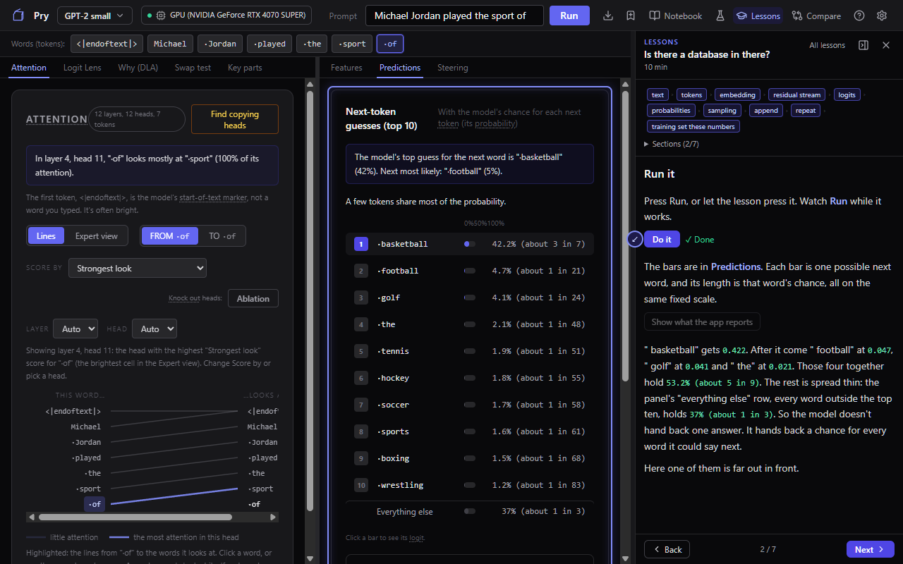
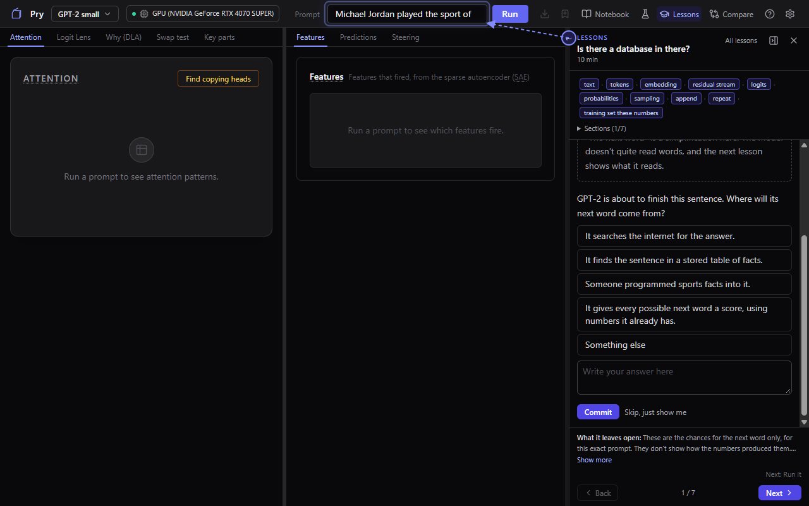
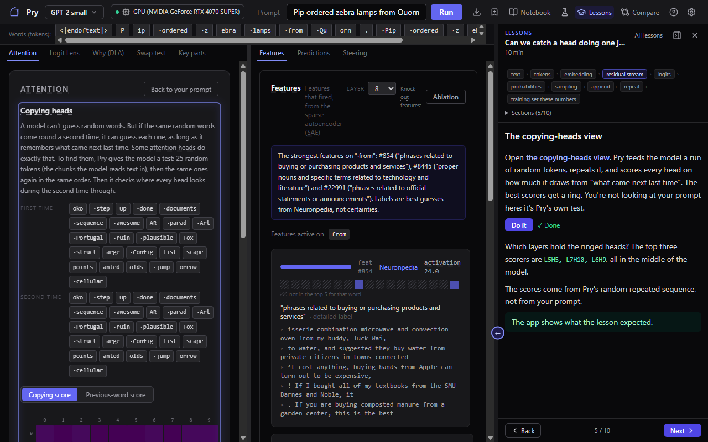
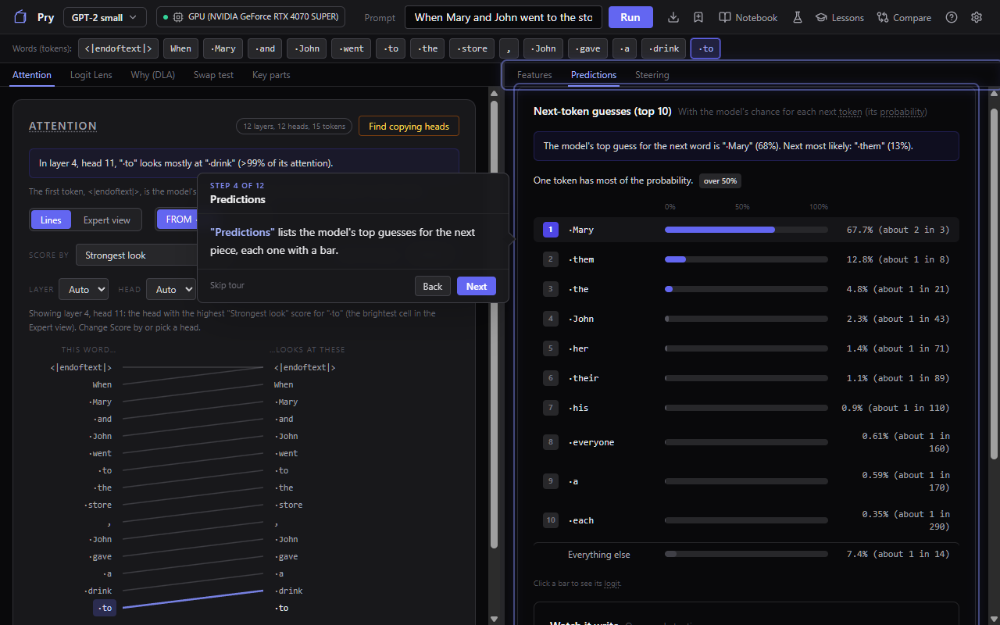
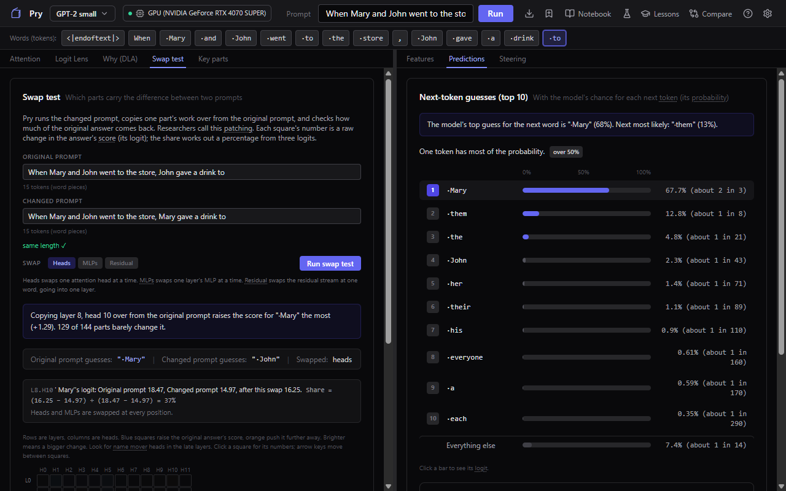

# Pry

Pry lets you look inside a small language model while it reads your words and guesses the next one.

It runs the model on your own computer and gives you tools for seeing what's going on inside. Each chart opens with a sentence or two saying what it shows, and each number sits next to the measurements behind it. Nineteen short lessons teach you how to read all of it, one section at a time, inside the app. If you've wondered how these models work and would rather look than code, it's for you.

Pry's an alpha. It works, but you'll hit rough edges.


*Attention and Predictions for "The cat sat on the". On the left, lines run from " the" to the words one head looks at. On the right are the model's top guesses, with " floor" first at 8.7%. Each bar is as wide as its probability, so that bar fills 8.7% of its track, and "Everything else" (58.7% here) is whatever the top ten leave over.*

## Lessons

Open **Lessons** from the header and a sidebar docks beside the app. A lesson runs Pry for you one section at a time: it types the prompt, opens the panel and runs the analysis, then tells you what you're looking at. It'll ask for your guess before it shows you a result, and every result has a line under it saying how far you can trust it.

The 19 lessons come in four stages:

1. What a model is made of: tokens, embeddings, the residual stream, logits and probabilities.
2. Looking inside: attention heads, the logit lens, direct logit attribution (DLA) and SAE features.
3. Testing what's a cause: knockouts, activation patching (Pry's Swap test), steering, and two case studies.
4. Why GPT-2 doesn't act like ChatGPT.

Back and Next put the app back the way that section had it, prompt and panels included, so you can step back to an earlier result. Press **Lessons** again to close it and you've got the plain analysis app. Settings picks which side the sidebar docks on. At 1024 pixels wide the app gets tabs so both fit.

New to Pry? The 12-step quick tour points at each part of the app in about five minutes. It's under the **?** button.



*Section 2 of "Is there a database in there?" The lesson ran "Michael Jordan played the sport of" and opened Predictions, and quotes the panel's own numbers: " basketball" at 0.422, and 37% left for everything outside the top ten.*



*The first section of the same lesson asks where GPT-2's next word comes from before it runs anything. You can pick an answer, write your own, or skip it.*



*"Can we catch a head doing one job?" runs Pry's copying-heads test, names the top three scorers it found (L5H5, L7H10, L6H9) and checks them against the app: "The app shows what the lesson expected."*



*Step 4 of the quick tour. The card sits beside Predictions, the part it's talking about, on a run of the Mary and John sentence.*

### Write your own

Lessons are Markdown files in a public format with its own version number, `format: 1`. For 0.4.x, writing your own is a **preview**... but format 1's frozen, so a lesson you write now keeps opening. [`docs/lessons/AUTHORING.md`](docs/lessons/AUTHORING.md) walks you from the template to an installed lesson, and a checker (`lessons-lint.mjs`, shipped with Pry) reads your file before Pry loads it. Turn on author mode in Settings > Lessons and each number in a lesson shows its expected value beside the live one.

When you install someone's lesson with **Add a lesson...**, Pry lists anything it does beyond looking at the app (downloading a model, looking something up online, opening a link) and asks you once. You can take that back in Settings > Lessons.

## What you can do

- **See what it guesses.** Predictions lists the model's top guesses for the next token with each one's probability, and the bars are drawn to scale. Click a bar to see its logit, the raw score the probability comes from. Watch it write replays the model writing one token at a time, with a temperature slider.
- **See where it looks.** Attention draws lines from each token to the tokens one attention head looks at. An expert view has the full layer × head grid, and a copying-heads view finds the heads that copy patterns they've already seen.
- **Watch the guess form.** The Logit Lens shows what the model would guess at each layer, so you can watch the answer form on the way up.
- **Ask why it guessed that.** Why (DLA) splits the guess into how much each head and MLP pushed toward it or away from it. Pick the answer token, and a second token to compare it against if you want. A line under the bars gives the bars' total, the model's logit and the gap between them, so you can see how much the bars account for. Key parts picks out the parts that matter most and draws the links between them.
- **See the concepts it used.** Features shows the concepts active at each token, from a sparse autoencoder (SAE), with labels from Neuronpedia. Find a concept searches those labels for something like "the ocean".
- **Poke it.** Swap test (activation patching) copies pieces from one prompt's run into another's to find which part carries the answer. Above the grid you get the target token's logit in all three runs (Original, Changed, and after the swap), and each square's share is worked out from them. Knockouts switch off a head or a feature. Steering turns a concept up or down and reruns, and shows how natural each text reads to the unsteered model (both numbers), next to a control run that steers a different feature of about the same size.
- **Compare two prompts.** Compare runs "The doctor said that" and "The nurse said that" side by side and shows what changed.
- **Read an embedding.** A view in the lessons puts two token positions side by side and counts how many of their 768 numbers match, with the token embedding and the positional embedding as separate rows.
- **Keep a lab notebook.** Save a run with your own note, come back to it later, and export one entry or the whole notebook as a single web page that works offline. Your lesson answers go in it too.
- **Learn as you go.** First-time tips and glossary hovers explain words like *attention head* and *logit* in a line.

## Screenshots


*The Logit Lens for "Michael Jordan played the sport of". Each square shows one layer's best guess for one token, and " basketball" takes over at layer 8, peaks at 93% at layer 9 and ends at 42%.*


*Why (DLA) on "When Mary and John went to the store, John gave a drink to", with " Mary" as the answer and " John" as the contrast. Each bar is one head or MLP pushing " Mary" over " John" (blue) or the other way (orange). The line at the bottom adds it up: the bars total 4.56, the model's logits are 18.47 and 15.10 (a difference of 3.36), and the gap of -1.20 is the part no bar shows.*



*Swap test on the same sentence, with "Mary gave a drink to" as the changed prompt. For layer 8, head 10, the line above the grid gives " Mary"'s logit in all three runs (18.47 original, 14.97 changed, 16.25 after the swap) and gives the share: (16.25 - 14.97) ÷ (18.47 - 14.97) = 37%.*


*Key parts on the same sentence. Each row's a layer, highest at the top, and the lines show how one part's output pushes the guess through a later head. The biggest part here, layer 10 head 7, pushes against " Mary" (-3.16).*


*Features on " would" in "The doctor told the nurse she would". You see the SAE features that lit up, Neuronpedia's label for each, and text where each one fires hardest. The strongest is #17000, "statements indicating future intentions".*


*Compare "The doctor said that" with "The nurse said that". " she" gains 14 points, " he" loses 12, and the features that show up in only one prompt are listed on the right.*


*The loading screen. It shows which step it's on and how long it's been, with tips to flip through while you wait.*

## What to keep in mind

Each of these tools answers one narrow question, and the app says which beside each result:

- Why (DLA) shows **direct** effects only: what each part adds straight to the final guess. Effects that pass through later layers aren't counted. The gap line shows what the bars leave out: the embedding's own direct push plus two biases.
- The lines in Key parts show one kind of link, the **direct value path**. Other ways parts affect each other, like changing where a head looks, aren't drawn.
- Compare shows what changes **along with** the prompt. It doesn't prove what causes what. Use Swap test or a knockout for that.
- A Swap test share only means something when the Original and Changed logits are far apart. When they're close, Pry says so.
- Steering's "how natural it reads" numbers can't tell good text from a loop: repetitive text scores as very natural. So Pry shows you the two numbers and a control run and leaves the call to you.
- Neuronpedia writes the feature labels automatically, so treat them as a good hint.

## Models

| Model | Download | Runs on | Features |
|---|---|---|---|
| GPT-2 small | 600 MB | GPU or CPU | Yes |
| Pythia-70M | 350 MB | GPU or CPU | Yes |
| Gemma 2 2B | 10.8 GB | GPU only | Yes (Gemma Scope) |

- Start with GPT-2 small. The lessons and the quick tour use it.
- On a computer without a graphics card, GPT-2 small and Pythia-70M run on the CPU. They're slower, but they work.
- Gemma 2 2B needs an NVIDIA GPU with about 8 GB of memory free (it fits a 12 GB card). Google also asks for two things first, and Pry walks you through both: a free Hugging Face account where you've accepted the Gemma license, and a Hugging Face token saved in Pry.
- **Add your own.** Type a Hugging Face model name and Pry checks it's a kind TransformerLens supports and tells you whether it'll fit. Most panels work on these. Features and Steering don't, since they need a trained sparse autoencoder (SAE) that Pry only has for the built-in models.

## Requirements

- Windows 10 or 11, 64-bit. Pry's Windows only.
- For the GPU: an NVIDIA card. GPT-2 small needs about 2 GB of graphics memory. RTX 50-series cards need NVIDIA driver 572.30 or newer.
- Without a GPU: 8 GB of RAM is plenty for GPT-2 small and Pythia-70M on the CPU.
- Disk space for the engine plus the models you pick. While it installs, the engine needs about 3.5 GB free for the CPU version, 7 GB for the GPU version, or 11 GB on an RTX 50-series card.

## Install

Download the latest `Pry_x.y.z_x64-setup.exe` from [Releases](https://github.com/BeargleIndustries/pry/releases), run it, and open Pry from the Start menu.

The first time it opens, Pry sets up its engine (Python, PyTorch and the interpretability libraries) in its own folder. It's a one-time download, picked to match your computer:

- NVIDIA GPU: about 2.7 GB
- RTX 50-series: about 3.5 GB
- No GPU: about 420 MB

Then it downloads the model you choose.

Loading a model can take a minute, and the first load after a restart is the slowest.

**Updates.** From 0.3.7 on, Pry checks for a new version when it starts and can install it in place with one click. Your models, notebook and settings are kept. Every update is signed, and Pry won't install one whose signature doesn't match. You can turn the check off in Settings.

**Coming from 0.3.8?** 0.4.0 moves the notebook to version 2, which keeps your lesson answers and where each run came from (the model's revision and the SAE). Pry 0.3.8 can't open a version 2 notebook. Before its first save, 0.4.0 copies your old notebook, byte for byte, to `notebook.v1.json` in the same folder. To go back to 0.3.8, rename `notebook.v1.json` to `notebook.json`. Anything you saved in 0.4.0 won't be in it, so export that first.

## Privacy

Your prompts, results, lab notebook and lesson answers stay on your computer, and Pry doesn't track usage.

Pry does go online for these:

- **Setup and model downloads.** The engine comes from the Python and PyTorch download sites, and models come from Hugging Face. Pry also asks Hugging Face to check a model name you add, and whether your account has the Gemma license.
- **Feature labels.** Pry asks Neuronpedia for the label of each feature it shows, by feature number. Your prompt isn't sent.
- **Find a concept.** The words you search for go to Neuronpedia. The panel tells you before you search.
- **Update check.** When it starts, Pry asks github.com whether there's a newer version.

The lessons that ship with Pry don't go online for anything beyond that list. A lesson you add can only look something up online if it says so in its `network` permission and you OK'd it, and it can only open links to the sites its `external` permission names.

Lessons you add live in Pry's app data folder, `%APPDATA%\com.beargle.pry\lessons`. What you OK'd for each one is in `lesson-grants.json` in the same folder, next to `notebook.json`.

## Build from source

You'll need:

- [Rust](https://rustup.rs/) (stable) and the Tauri CLI: `cargo install tauri-cli --version "^2"`
- [Node.js](https://nodejs.org/) 20 or newer (22 or newer if you want to run the dev-only popup audit in `scripts/dev/`)
- Windows with the [WebView2 runtime](https://developer.microsoft.com/microsoft-edge/webview2/) (it's already on Windows 11)

You don't need Python installed to build or run the app. On first launch Pry downloads its own Python 3.12 and builds its engine, same as the installed version.

```powershell
git clone https://github.com/BeargleIndustries/pry.git
cd pry
npm ci --prefix ui
cargo tauri dev
```

`cargo tauri dev` starts the UI dev server on port 5173 and opens the app with live reload.

**Working on the engine.** The Python side lives in `sidecar/` and needs Python 3.11 or 3.12. [`sidecar/README.md`](sidecar/README.md) has setup and tests.

**Working on lessons.** The bundled lessons are in `ui/src/lessons/`, one folder each. `node ui/build-cli/lessons-lint.mjs ui/src/lessons --release` checks all of them.

**Signed releases.** `scripts/release.ps1` builds a signed installer and the update manifest. It needs the updater signing key, so it's only for official releases. See [`docs/releasing.md`](docs/releasing.md).

The `pry-cli` binary in `src-tauri/src/cli.rs` runs the engine on its own for debugging. You won't need it for normal use.

## Built with

- [Tauri 2](https://v2.tauri.app/), the desktop shell
- [SvelteKit](https://svelte.dev/docs/kit) and Svelte 5, the interface
- [TransformerLens](https://github.com/TransformerLensOrg/TransformerLens), for looking inside the model
- [SAELens](https://github.com/jbloomAus/SAELens), for the sparse autoencoders (SAEs)
- [PyTorch](https://pytorch.org/), for the math
- [Neuronpedia](https://www.neuronpedia.org/), for feature labels and concept search
- [Tailwind CSS](https://tailwindcss.com/), for styling

You'll find the third-party licenses in [THIRD_PARTY_NOTICES.md](THIRD_PARTY_NOTICES.md).

## License

MIT. See [LICENSE](LICENSE).

## Credits

Built by Brad at [Beargle Industries](https://beargleindustries.com).
